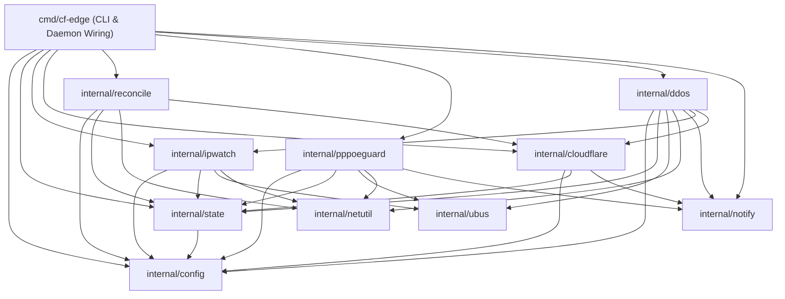

# Thiết kế kiến trúc hệ thống: `cf-edge`

Tài liệu này mô tả kiến trúc chi tiết của `cf-edge` dựa trên đặc tả tại [SPEC.md](./SPEC.md), làm cơ sở thống nhất trước khi triển khai mã nguồn.

---

## 1. Tổng quan kiến trúc & Nguyên tắc thiết kế

- **Mục tiêu biên dịch & vận hành:** Pure Go (`CGO_ENABLED=0`), xuất ra 1 static binary duy nhất cho `linux/arm64` và `linux/amd64`, tối ưu footprint bộ nhớ (`GOMEMLIMIT=32MiB`), không phụ thuộc các công cụ userland như `curl`, `jq`, `awk`, `nslookup`, `uhttpd`.
- **Tương tác hệ thống OpenWrt tối giản:**
  - Sử dụng `ubus` (CLI có sẵn trong base image OpenWrt) cho `network.interface` (`status`, `listen`, `up`, `down`) và `nft` (nftables `fw4`) cho việc chặn port ingress khi kích hoạt DDoS Shield.
  - Sử dụng trực tiếp Linux Netlink (`NETLINK_ROUTE`), `/proc`, `/sys`, và Raw ICMP socket (`SO_BINDTODEVICE`) bằng Pure Go để đọc địa chỉ IPv6 (kiểm tra cờ `IFA_F_DEPRECATED`), default route, bộ đếm lưu lượng và ping kiểm tra mạng qua đúng `l3_device` — giảm tối đa chi phí `fork/exec` trong vòng lặp giám sát 5s.
- **Tách biệt Read-Only Config, RAM State & Flash Lock:**
  - `/etc/cf-edge/config.yaml`: **chỉ đọc (Read-Only)**.
  - `/tmp/cf-edge-state.json`: lưu trong `tmpfs` (RAM), ghi nguyên tử (`temp file + fsync + rename`) kết hợp `flock` để đồng bộ an toàn giữa `cf-edge daemon` và các lệnh CLI (`cf-edge update`, `cf-edge status`).
  - `/etc/cf-edge/shield.lock`: lưu trên flash để sống sót qua reboot/mất điện.
- **Quy tắc module hóa:**
  - Bảo toàn đầy đủ 8 package chức năng trong `SPEC.md`: `config`, `ipwatch`, `cloudflare`, `reconcile`, `pppoeguard`, `ddos`, `notify`, `state`.
  - Bổ sung 2 package nền tảng dùng chung là `internal/ubus` và `internal/netutil` (thay vì nhét vào `ipwatch` hay nhân bản mã nguồn giữa `ipwatch`, `pppoeguard` và `ddos`), giúp đồ thị phụ thuộc (DAG) hoàn toàn một chiều, không có circular import và giữ mỗi file `.go` tập trung 1 trách nhiệm (≤ 250 dòng).
  - Mọi phụ thuộc I/O bên ngoài (`ubus`, `nft`, Netlink, ICMP, HTTP, DNS) đều trừu tượng hóa qua Go `interface` để dễ dàng viết Unit Test (`go test ./...`) trên cả Windows/Linux.
  
  "Lưu ý: mức ~250 dòng/file chỉ là khuyến nghị mềm để tránh gom nhiều trách nhiệm vào 1 file, không phải giới hạn cứng. Nếu một file làm đúng 1 trách nhiệm (như netlink_linux.go, dns_query.go, shield.go) cần 300–400 dòng để xử lý lỗi đầy đủ và dễ đọc thì cứ giữ nguyên, không tách vụn vô nghĩa. Riêng các file test (*_test.go) thì không giới hạn số dòng, cứ viết đầy đủ mọi edge-case."

### Đồ thị phụ thuộc giữa các package



---

## 2. Cây thư mục dự án

```text
openwrt-cf-mesh/
├── .github/
│   └── workflows/
│       └── release.yml                 # CI chạy `go test ./...`, cross-compile linux/arm64 & linux/amd64, tạo SHA256 & GitHub Release
├── cmd/
│   └── cf-edge/
│       ├── main.go                     # Entrypoint, phân luồng subcommand, version metadata (-ldflags)
│       ├── daemon.go                   # Khởi tạo & điều phối vòng đời toàn bộ goroutine trong chế độ daemon
│       ├── cmd_update.go               # Xử lý lệnh `cf-edge update [--force]`
│       ├── cmd_status.go               # Xử lý lệnh `cf-edge status`
│       ├── cmd_shield.go               # Xử lý lệnh `cf-edge shield enter|exit|status`
│       ├── cmd_selfupdate.go           # Xử lý lệnh `cf-edge self-update` (tải release, verify SHA256, atomic replace, --restart)
│       └── cmd_selfupdate_test.go      # Unit test verify SHA256 & atomic replace
├── internal/
│   ├── config/
│   │   ├── config.go                   # Định nghĩa struct Config, kiểu Duration, hàm Load(path)
│   │   ├── validate.go                 # Gán giá trị mặc định & kiểm tra hợp lệ toàn bộ cấu hình
│   │   └── config_test.go              # Unit test đọc YAML, mặc định, và các ca lỗi cấu hình
│   ├── state/
│   │   ├── state.go                    # RuntimeState, RecordState, quản lý RAM + /tmp/cf-edge-state.json (atomic write)
│   │   ├── flock_unix.go               # File lock (`syscall.Flock`) trên Linux/macOS
│   │   ├── flock_other.go              # Stub flock cho non-Unix (Windows dev)
│   │   ├── shield_lock.go              # Đọc/ghi/xóa nguyên tử `/etc/cf-edge/shield.lock`
│   │   └── state_test.go               # Unit test lưu/tải state, concurrency, và shield.lock
│   ├── ubus/
│   │   ├── client.go                   # Interface Runner + `ubus call network.interface.<iface> status|down|up`
│   │   ├── listener.go                 # Quản lý `ubus listen network.interface` tự khởi động lại & fan-out event
│   │   └── ubus_test.go                # Unit test parse ubus JSON & phân phối sự kiện
│   ├── netutil/
│   │   ├── ipfilter.go                 # Phân loại Private/CGNAT/GUA IPv4 & IPv6, kiểm tra CIDR Cloudflare Proxy
│   │   ├── netlink_linux.go            # Pure-Go Netlink RTM_GETADDR (lọc IFA_F_DEPRECATED) & RTM_GETROUTE (default route)
│   │   ├── netlink_stub.go             # Stub cho non-Linux để chạy `go test` trên máy dev Windows/macOS
│   │   ├── ping_linux.go               # Pure-Go ICMP Echo bound vào l3_device (SO_BINDTODEVICE), lọc ICMP ID + Sequence
│   │   ├── ping_stub.go                # Stub non-Linux cho ping
│   │   └── netutil_test.go             # Unit test IP filtering & CIDR matching
│   ├── ipwatch/
│   │   ├── ipv4.go                     # Thu thập IPv4 (ubus -> default route fallback -> NAT trace probe)
│   │   ├── ipv6.go                     # Thu thập IPv6 (Netlink GUA non-deprecated -> api64 fallback)
│   │   ├── discover.go                 # Điều phối thu thập song song IPv4 & IPv6 (6x5s, retry loop)
│   │   ├── watcher.go                  # Lắng nghe sự kiện ubus, preemption qua Context & tôn trọng shield.lock
│   │   └── ipwatch_test.go             # Unit test NAT fallback, loại private IP, lọc deprecated IPv6, preemption
│   ├── cloudflare/
│   │   ├── client.go                   # Client HTTP REST v4 tới Cloudflare API (GET/POST/PUT/DELETE DNS records)
│   │   ├── updater.go                  # Engine đồng bộ DNS (Mutex, cooldown 10s, global retry 3x15s)
│   │   ├── sync_record.go              # Đồng bộ từng record (dedup, stale cleanup, fallback POST, API retry)
│   │   └── cloudflare_test.go          # Unit test với httptest mock (dedup, stale, ID not found -> POST, retry)
│   ├── reconcile/
│   │   ├── dns_query.go                # Pure-Go UDP/TCP DNS query gửi trực tiếp tới 1.1.1.1/8.8.8.8/1.0.0.1
│   │   ├── cf_ips.go                   # Tải động dải IP Proxy Cloudflare (cache 24h + static fallback)
│   │   ├── reconciler.go               # Vòng lặp đối soát (delay 15s, chu kỳ 10m, bỏ qua khi proxied/shield)
│   │   └── reconcile_test.go           # Unit test NXDOMAIN/NODATA/CF-Proxy/NET_ERROR với mock DNS server
│   ├── pppoeguard/
│   │   ├── health.go                   # Kiểm tra sức khỏe WAN (ubus up + có IPv4 + ping >= 1 target qua l3_device)
│   │   ├── guard.go                    # Điều phối sự kiện ubus & vòng đời PPPoE Guard
│   │   ├── recover.go                  # State machine phục hồi PPPoE (90s boot grace, 45s wait, pending/auth recovery)
│   │   └── pppoeguard_test.go          # Unit test logic pending/AUTH_FAILED, backoff 60s/120s
│   ├── ddos/
│   │   ├── metrics.go                  # Đọc nf_conntrack_count & statistics/{rx_bytes,rx_packets,tx_bytes} từ procfs/sysfs
│   │   ├── firewall.go                 # Quản lý bảng riêng `table inet cf_edge_shield` qua `nft` (`iifname`, ingress only)
│   │   ├── worker_client.go            # HTTP client gọi Cloudflare Worker (`/edge/ddos`, `/edge/status`)
│   │   ├── shield.go                   # Quản lý trạng thái ShieldManager, EnterShield & ExitShield
│   │   ├── redial.go                   # Logic giới hạn redial/giờ & ngắt/quay lại PPPoE an toàn
│   │   ├── detector.go                 # Detector 5s/25s sustain & vòng polling Worker 2m
│   │   └── ddos_test.go                # Unit test state machine detector, tính toán Mbps/PPS, giới hạn redial/giờ
│   └── notify/
│       ├── telegram.go                 # Client gửi thông báo Telegram Bot API (xác nhận HTTP 200 & JSON "ok":true)
│       └── telegram_test.go            # Unit test xác thực phản hồi OK/lỗi của Telegram API
├── openwrt/
│   ├── cf-edge.init                    # Script `procd` (respawn, GOMEMLIMIT=32MiB)
│   └── install.sh                      # Script cài đặt POSIX sh tự nhận diện kiến trúc & tải từ GitHub Releases
├── configs/
│   └── config.example.yaml             # File cấu hình mẫu đầy đủ các trường theo SPEC.md
├── go.mod
├── go.sum
├── SPEC.md
└── ARCHITECTURE.md
```

---

## 3. Trách nhiệm từng Package

### `cmd/cf-edge`
- Phân tích CLI flags (`-c /etc/cf-edge/config.yaml`, `--force`, `--no-redial`, v.v.) và điều phối 5 lệnh chính:
  - `daemon`: nạp config, khôi phục state & kiểm tra `shield.lock` lúc khởi động, chạy đồng thời các goroutine (`ubus.Listener`, `ipwatch.Watcher`, `reconcile.Reconciler`, `pppoeguard.Guard`, `ddos.ShieldManager`), lắng nghe `SIGINT`/`SIGTERM` để graceful shutdown.
  - `update [--force]`: kiểm tra `shield.lock` (từ chối cập nhật nếu đang bị khóa trừ khi gỡ shield), thu thập IP WAN hiện tại qua `ipwatch.Discoverer`, gọi `cloudflare.Updater.Sync`.
  - `status`: tổng hợp và in bảng trạng thái trực tiếp gồm: IPv4/IPv6 WAN hiện tại vs state đã đẩy lên Cloudflare, trạng thái `shield.lock` & rule `nft`, trạng thái giao diện `ubus` (`up`, `pending`, `l3_device`, `uptime`) và thông tin PPPoE Guard gần nhất.
  - `shield enter|exit|status`: điều khiển thủ công chế độ ẩn mình (`EnterShield` hỗ trợ `--no-redial` / `ExitShield` / đọc trạng thái lock + `nft`).
  - `self-update`: truy vấn GitHub Releases API (`diepkhoa/openwrt-cf-edge` mặc định) lấy release mới nhất cho `linux/<GOARCH>`, kiểm tra SHA256 checksum, ghi file tạm cùng thư mục với binary đang chạy, `os.Rename` nguyên tử, và hỗ trợ cờ `--restart` tự gọi `/etc/init.d/cf-edge restart`.

### `internal/config`
- Đọc và giải mã file YAML chỉ đọc (`/etc/cf-edge/config.yaml`), hỗ trợ kiểu `Duration` cho chuỗi thời gian chuẩn Go (`"10m"`, `"90s"`, `"2m"`).
- Gán mặc định an toàn (`os.Hostname()` cho `node_name`, các mốc thời gian, DNS resolvers, ping targets) và validate ràng buộc logic trước khi daemon chạy.

### `internal/state`
- Quản lý bộ nhớ cache trạng thái động (`record_id`, `last_ip_v4`, `last_ip_v6`, danh sách bản ghi đã đồng bộ, cache 24h Cloudflare Proxy CIDRs, lịch sử redial, trạng thái PPPoE Guard).
- Lưu xuống `/tmp/cf-edge-state.json` bằng ghi nguyên tử kết hợp `syscall.Flock` trên file lock phụ `/tmp/cf-edge-state.json.lock` để tiến trình daemon và CLI không ghi đè lẫn nhau.
- Quản lý độc lập `/etc/cf-edge/shield.lock` (ghi JSON metadata: thời điểm vào shield, lý do, chế độ thủ công/tự động, IP tại thời điểm khóa).

### `internal/ubus`
- Đóng gói giao tiếp với `ubus` của OpenWrt thông qua `CommandRunner` interface (có timeout cho mọi `ubus call`).
- Cung cấp `Listener` chạy `ubus listen network.interface`, tự động khởi động lại stream (backoff 1s → 10s) nếu kết nối bị ngắt, và phân phát event (`action`, `interface`, `l3_device`) qua kênh non-blocking tới nhiều subscriber (`ipwatch`, `pppoeguard`, `ddos`).

### `internal/netutil`
- Hàm thuần túy phân loại địa chỉ IP: nhận diện Private/CGNAT IPv4 (`10.0.0.0/8`, `172.16.0.0/12`, `192.168.0.0/16`, `100.64.0.0/10`, loopback, link-local), nhận diện IPv6 Global Unicast (`2000::/3`), đối chiếu CIDR Cloudflare Proxy.
- `Netlink` (Linux): đọc danh sách IPv6 của `l3_device` bằng `RTM_GETADDR` để kiểm tra chính xác cờ `IFA_F_DEPRECATED` (`preferred_lft == 0`); đọc `RTM_GETROUTE` tìm interface giữ default route IPv4 (loại trừ `wg*`, `wt*`, `warp*`, `tun*`).
- `Pinger` (Linux): gửi/nhận ICMP Echo trực tiếp trên raw socket bind vào đúng `l3_device` (`SO_BINDTODEVICE`), lọc chính xác cả **ICMP ID + Sequence** khi đọc gói tin phản hồi để loại bỏ nhiễu từ các socket/tiến trình ICMP khác trên hệ thống.

### `internal/ipwatch`
- Điều phối thu thập song song IPv4 và IPv6 (`errgroup` / 2 goroutine), tối đa **6 lần thử**, cách nhau **5 giây**, hủy ngay lập tức khi nhận `context.CancelFunc`.
- Chỉ kích hoạt luồng IPv6 khi có ít nhất 1 record trong config bật `ipv6: true`.
- **IPv4:** `ubus status` → fallback default route interface → kiểm tra dải Private/CGNAT → nếu NAT thì probe qua HTTP (`1.1.1.1/cdn-cgi/trace`, fallback `api.ipify.org`, timeout 3s, bind IPv4 WAN); thất bại trả rỗng để retry, tuyệt đối không đẩy Private IP.
- **IPv6:** lấy `l3_device` từ `ubus` (`iface_v6` → fallback `iface_v4`) → đọc Netlink GUA `2000::/3` bỏ `deprecated` → fallback `api64.ipify.org` (timeout 3s, bind WAN `l3_device`).
- Lắng nghe sự kiện `ifup` / `ifupdate` từ `ubus.Listener`; hủy lượt update cũ đang dở nếu có sự kiện mới (**preemption**); bỏ qua hoàn toàn nếu `/etc/cf-edge/shield.lock` đang tồn tại.

### `internal/cloudflare`
- Client REST v4 gọi `GET`, `POST`, `PUT`, `DELETE` tới `https://api.cloudflare.com/client/v4/zones/{zone_id}/dns_records`.
- `Updater` dùng `sync.Mutex` tuần tự hóa mọi thao tác ghi DNS (hỗ trợ đồng bộ toàn bộ record hoặc chỉ 1 subdomain cho `reconcile`).
- Cooldown 10s cho trigger thường (nếu IP không đổi so với state thì bỏ qua ngay; nếu IP mới khác state thì đợi phần thời gian cooldown còn lại thay vì bỏ sót); `--force` bỏ qua cooldown và luôn đối chiếu lại với API.
- Khi `record_id` chưa có hoặc `--force`: `GET` bản ghi theo `type` + `name`, giữ bản ghi đầu tiên khớp `content == target_ip` làm `record_id`, `DELETE` các bản ghi trùng lặp hoặc stale (nếu không bản ghi nào khớp `target_ip` thì giữ `[0]` để `PUT` cập nhật tại chỗ và `DELETE` các bản ghi thừa `[1:]`, hoặc `POST` nếu rỗng).
- Hỗ trợ retry 3 lần (5s) khi lỗi mạng/5xx; khi gặp lỗi ID không tồn tại (`not found` / `not a valid` / `does not exist` / 404) thì xóa `record_id` khỏi state và tự chuyển sang `POST`.
- Global retry tối đa 3 lượt (nghỉ 15s giữa các lượt) cho các record còn lỗi; khi cập nhật thành công sẽ lưu state và gửi thông báo Telegram.

### `internal/reconcile`
- Chờ 15s sau khi daemon khởi động, sau đó lặp theo `reconcile.interval` (mặc định `10m`).
- Bỏ qua toàn bộ lượt nếu `shield.lock` tồn tại; bỏ qua các record có `proxied: true`.
- Resolver Pure-Go gửi gói DNS UDP (tự fallback TCP khi cờ `TC=1`) trực tiếp tới lần lượt `1.1.1.1:53`, `8.8.8.8:53`, `1.0.0.1:53`.
- Phân biệt rõ `NET_ERROR` (cả 3 resolver timeout/lỗi mạng → bỏ qua không hành động) với `NXDOMAIN`, `NODATA`, IP thuộc Cloudflare Proxy (từ `api.cloudflare.com/client/v4/ips` cache 24h + static fallback), hoặc lệch IP state → kích hoạt `--force` update cho đúng subdomain đó.

### `internal/pppoeguard`
- Chỉ hoạt động khi `pppoe_guard.enabled == true`.
- Dùng chung luồng `ubus.Listener` (0% CPU khi WAN ổn định).
- Sau `boot_grace` (90s) hoặc khi nhận `ifdown` / `ifup-failed` trên `iface_v4`:
  - Tự tạm hoãn nếu `ddos.IsRedialing()` đang bật (tránh can thiệp vào 20s xả phiên BRAS của `EnterShield`).
  - Đợi `initial_wait` (45s) cho `pppd` tự khôi phục; kiểm tra `ubus status` (`up == true`, có IPv4) và `Pinger` thông ít nhất 1 `ping_targets` qua `l3_device`.
  - Xử lý `pending == false` (`AUTH_FAILED` / `proto_block_restart`): `down` → 10s → `up`.
  - Xử lý `pending == true` quá 3 chu kỳ: `down` → 15s → `up`.
  - Chu kỳ lặp 60s (5 lần đầu) → 120s (các lần sau) cho tới khi khỏe lại rồi ngủ.

### `internal/ddos`
- Giám sát đa tín hiệu mỗi `check_interval` (5s): đọc `nf_conntrack_count`, `rx_bytes`/`rx_packets` của `wan_l3`, `tx_bytes` của `overlay_iface` và tùy chọn `tx_bytes` của `wan.lan_iface` (mặc định rỗng; nếu cấu hình ví dụ `br-lan` thì tính `Junk_Mbps = max(0, RX_WAN - TX_OVERLAY - TX_LAN)`).
- Nếu `conntrack > conntrack_threshold` HOẶC `(Junk_Mbps > junk_mbps_threshold) && (ping_fail || RX_PPS > rx_pps_threshold)` (mặc định `rx_pps_threshold = 80000`) liên tục trong `sustain_duration` (25s) → kích hoạt `EnterShield` (bảo vệ bằng `sync.Mutex` + giới hạn `max_redials_per_hour`).
- Quy trình `EnterShield`:
  1. Ghi `/etc/cf-edge/shield.lock`.
  2. Áp rule `nft` trong bảng riêng `table inet cf_edge_shield` (hook `input` & `forward` priority `-10`) bắt buộc dùng **`iifname`** (không dùng `iif` để tránh gãy rule khi PPPoE đổi `ifindex`), chỉ drop `tcp dport <wan_ingress_port>` và `udp dport <wan_ingress_port>` chiều vào từ WAN `l3_device` (tuyệt đối không ảnh hưởng traffic outbound ra port 443 và giữ nguyên 100% traffic trên `overlay_iface`).
  3. Ngắt và quay lại cả `iface_v4` và `iface_v6` (nghỉ 20s xả BRAS, chờ kết nối lại tối đa 120s — nếu vượt `max_redials_per_hour` hoặc chạy với `--no-redial` thì bỏ qua bước redial nhưng vẫn giữ `shield.lock` + `nft` và vẫn thực hiện bước báo Worker/Telegram).
  4. Thu thập IP mới, gửi `POST <worker_url>/edge/ddos` (`Authorization: Bearer <worker_token>`, JSON `{"new_ip":"...","reason":"..."}`, tối đa 5 lần retry) và bắn thông báo Telegram.
- Vòng chờ phục hồi (khi `shield.lock` tồn tại, kể cả sau khi router reboot):
  - Đảm bảo rule `nft` được áp lại ngay lúc khởi động daemon.
  - Định kỳ mỗi `status_poll_interval` (2m) gọi `GET <worker_url>/edge/status` (`Authorization: Bearer <worker_token>`, JSON `{"action":"hold"|"resume"}`).
  - Khi Worker trả về `{"action": "resume"}` (hoặc người dùng chạy `cf-edge shield exit`): gỡ `table inet cf_edge_shield`, xóa `/etc/cf-edge/shield.lock`, và kích hoạt `update --force` ngay lập tức.

### `internal/notify`
- Giao tiếp Telegram Bot API `sendMessage` (timeout 10s), HTML-escape nội dung động, kiểm tra bắt buộc HTTP status `200` và trường JSON `"ok": true`.

---

## 4. Cấu trúc Struct cấu hình & Trạng thái

### 4.1. Struct Cấu hình (`internal/config/config.go`)

```go
package config

import "time"

// Duration wraps time.Duration to unmarshal Go duration strings (e.g. "10m", "90s") from YAML.
type Duration time.Duration

type Config struct {
	NodeName   string           `yaml:"node_name"`
	WAN        WANConfig        `yaml:"wan"`
	Cloudflare CloudflareConfig `yaml:"cloudflare"`
	Reconcile  ReconcileConfig  `yaml:"reconcile"`
	PPPoEGuard PPPoEGuardConfig `yaml:"pppoe_guard"`
	DDoSShield DDoSShieldConfig `yaml:"ddos_shield"`
	Telegram   TelegramConfig   `yaml:"telegram"`
}

type WANConfig struct {
	IfaceV4      string `yaml:"iface_v4"`      // Default: "wan"
	IfaceV6      string `yaml:"iface_v6"`      // Optional (empty if IPv6 disabled or shared on iface_v4)
	OverlayIface string `yaml:"overlay_iface"` // e.g. "wt0"
	LANIface     string `yaml:"lan_iface"`     // Optional, e.g. "br-lan" (trừ TX_LAN khỏi Junk_Mbps nếu có)
}

type CloudflareConfig struct {
	ZoneID   string         `yaml:"zone_id"`
	APIToken string         `yaml:"api_token"`
	Records  []RecordConfig `yaml:"records"`
}

type RecordConfig struct {
	Subdomain string `yaml:"subdomain"`
	IPv4      bool   `yaml:"ipv4"`
	IPv6      bool   `yaml:"ipv6"`
	Proxied   bool   `yaml:"proxied"`
}

type ReconcileConfig struct {
	Enabled   bool     `yaml:"enabled"`   // Default: true (when omitted)
	Interval  Duration `yaml:"interval"`  // Default: 10m
	Resolvers []string `yaml:"resolvers"` // Default: ["1.1.1.1:53", "8.8.8.8:53", "1.0.0.1:53"]
}

type PPPoEGuardConfig struct {
	Enabled     bool     `yaml:"enabled"`      // Default: false
	BootGrace   Duration `yaml:"boot_grace"`   // Default: 90s
	InitialWait Duration `yaml:"initial_wait"` // Default: 45s
	PingTargets []string `yaml:"ping_targets"` // Default: ["1.1.1.1", "8.8.8.8", "203.162.4.190"]
}

type DDoSShieldConfig struct {
	Enabled            bool     `yaml:"enabled"`              // Default: false
	WorkerURL          string   `yaml:"worker_url"`
	WorkerToken        string   `yaml:"worker_token"`
	WANIngressPort     int      `yaml:"wan_ingress_port"`     // Default: 443
	CheckInterval      Duration `yaml:"check_interval"`       // Default: 5s
	SustainDuration    Duration `yaml:"sustain_duration"`     // Default: 25s
	ConntrackThreshold int64    `yaml:"conntrack_threshold"`  // Default: 5000
	JunkMbpsThreshold  float64  `yaml:"junk_mbps_threshold"`  // Default: 300
	RXPPSThreshold     float64  `yaml:"rx_pps_threshold"`     // Default: 80000
	MaxRedialsPerHour  int      `yaml:"max_redials_per_hour"` // Default: 3
	StatusPollInterval Duration `yaml:"status_poll_interval"` // Default: 2m
}

type TelegramConfig struct {
	Enabled  bool   `yaml:"enabled"`
	BotToken string `yaml:"bot_token"`
	ChatID   string `yaml:"chat_id"`
}
```

### 4.2. Struct Trạng thái & Khóa (`internal/state`)

```go
// Lưu trong RAM và ghi ra /tmp/cf-edge-state.json
type RuntimeState struct {
	LastIPv4       string                 `json:"last_ip_v4,omitempty"`
	LastIPv6       string                 `json:"last_ip_v6,omitempty"`
	LastUpdated    time.Time              `json:"last_updated,omitempty"`
	Records        map[string]RecordState `json:"records,omitempty"` // key: "<subdomain>|<A|AAAA>"
	CFProxyCache   *CFProxyIPCache        `json:"cf_proxy_cache,omitempty"`
	RedialHistory  []time.Time            `json:"redial_history,omitempty"`
	PPPoEStatus    *PPPoERuntimeInfo      `json:"pppoe_status,omitempty"`
}

type RecordState struct {
	RecordID  string    `json:"record_id"`
	Subdomain string    `json:"subdomain"`
	Type      string    `json:"type"` // "A" | "AAAA"
	IP        string    `json:"ip"`
	Proxied   bool      `json:"proxied"`
	UpdatedAt time.Time `json:"updated_at"`
}

// Lưu bền trên flash tại /etc/cf-edge/shield.lock
type ShieldLock struct {
	Active         bool      `json:"active"`
	NodeName       string    `json:"node_name"`
	Reason         string    `json:"reason"`
	Manual         bool      `json:"manual"`
	WANIngressPort int       `json:"wan_ingress_port"`
	ShieldedIPv4   string    `json:"shielded_ipv4,omitempty"`
	ShieldedIPv6   string    `json:"shielded_ipv6,omitempty"`
	EnteredAt      time.Time `json:"entered_at"`
}
```

---

## 5. Luồng Goroutine, Đồng bộ hóa & Vòng đời

### 5.1. Sơ đồ kiến trúc Goroutine trong `cf-edge daemon`

```mermaid
flowchart LR
    MAIN["Goroutine 1: Main / Signal (SIGINT, SIGTERM)"] -->|Root Context| UBUS["Goroutine 2: ubus.Listener (ubus listen fan-out)"]
    MAIN -->|Root Context| IPW["Goroutine 3: ipwatch.Watcher"]
    MAIN -->|Root Context| REC["Goroutine 4: reconcile.Reconciler"]
    MAIN -->|Root Context| PPP["Goroutine 5: pppoeguard.Guard (nếu bật)"]
    MAIN -->|Root Context| DDOS["Goroutine 6: ddos.ShieldManager (nếu bật hoặc có shield.lock)"]

    UBUS -->|chan ifup/ifupdate| IPW
    UBUS -->|chan ifdown/ifup-failed/ifup| PPP
    UBUS -->|chan ifup/ifupdate| DDOS

    IPW -->|Preempt child ctx| DISC["Worker ngắn hạn: IPv4 + IPv6 parallel (6x5s)"]
    DISC -->|Sync(force=false)| CF["cloudflare.Updater (sync.Mutex)"]
    REC -->|Sync(force=true, sub)| CF
    DDOS -->|ExitShield -> Sync(force=true)| CF

    CF -->|flock + atomic rename| TMP["/tmp/cf-edge-state.json"]
    CF --> TG["notify.Telegram"]

    DDOS <-->|os.Stat / Read / Write| LOCK["/etc/cf-edge/shield.lock"]
    IPW -.->|Kiểm tra chặn trước update| LOCK
    REC -.->|Kiểm tra bỏ qua lượt| LOCK
```

### 5.2. Cơ chế đồng bộ và tránh xung đột

1. **Preemption khi WAN đổi IP liên tiếp (`ipwatch`):**
   - `ipwatch.Watcher` giữ 1 `activeCancel context.CancelFunc` và `activeDone chan struct{}` cho lượt thu thập + cập nhật hiện tại.
   - Khi nhận event `ifup`/`ifupdate` mới: kiểm tra `shield.lock` trước (có lock → bỏ qua); nếu không có lock → gọi `activeCancel()` để hủy ngay các `time.Sleep(5s)` hoặc HTTP probe/API call đang dở, đợi `activeDone` đóng lại, rồi mới khởi chạy goroutine worker mới. Đảm bảo tối đa chỉ có **1** lượt `ipwatch` worker chạy tại một thời điểm và không bao giờ rò goroutine.
2. **Tuần tự hóa ghi DNS (`cloudflare.Updater`):**
   - Mọi nguồn kích hoạt (`ipwatch`, `reconcile`, `ddos ExitShield`) đều đi qua `Updater.mu` (`sync.Mutex`) và được kiểm tra `shield.lock` một lần nữa ngay bên trong critical section trước khi ghi lên Cloudflare.
3. **Đồng bộ giữa Daemon và CLI (`cf-edge update` / `cf-edge shield`):**
   - CLI `update` và `daemon` dùng chung cơ chế khóa `flock` trên `/tmp/cf-edge-state.json.lock` khi đọc-sửa-ghi `/tmp/cf-edge-state.json`. Khi `daemon` thực hiện bước đọc state trong `Updater`, luôn đọc lại file từ `/tmp` nếu file có `mtime` mới hơn bản cache RAM.
   - CLI `shield enter` / `shield exit` tạo hoặc xóa trực tiếp `/etc/cf-edge/shield.lock` và thao tác `table inet cf_edge_shield`. Vòng lặp 5s của `ddos.ShieldManager` phát hiện sự xuất hiện/biến mất của `shield.lock` để đồng bộ chuyển trạng thái sang Recovery Mode hoặc trở lại Detection Mode mà không cần mở thêm cổng RPC/HTTP nội bộ.
4. **Phối hợp `ddos` Redial và `pppoeguard`:**
   - Trong lúc `EnterShield` ngắt `iface_v4`/`iface_v6` và chờ 20s xả phiên BRAS, `ddos.ShieldManager` đặt cờ nguyên tử `redialing = true` (hoặc gọi `pppoeguard.NotifyExternalRedial(true/false)`).
   - `pppoeguard` bỏ qua các sự kiện `ifdown` sinh ra trong khoảng thời gian đó để hai luồng không tranh nhau gọi `ubus down/up`.

---

## 6. Các điểm thiết kế đã thống nhất (Approved Decisions)

1. **Điều kiện băng thông của DDoS Detector (`SPEC.md` 3.5):**
   - Dùng công thức `conntrack > conntrack_threshold` **HOẶC** `(Junk_Mbps > junk_mbps_threshold) && (ping_fail || RX_PPS > rx_pps_threshold)` với mặc định `rx_pps_threshold = 80000`.
   - Bổ sung trường tùy chọn `wan.lan_iface` (mặc định rỗng; khi cấu hình vd `br-lan` sẽ tính `Junk_Mbps = max(0, RX_WAN - TX_OVERLAY - TX_LAN)`), đồng thời chỉ gửi ICMP ping khi `Junk_Mbps` vượt ngưỡng.
2. **Hành vi khi vượt ngưỡng `max_redials_per_hour`:**
   - Vẫn ghi `/etc/cf-edge/shield.lock`, giữ rule `nft` (`table inet cf_edge_shield` dùng `iifname`, chỉ drop `tcp/udp dport <wan_ingress_port>` trên ingress) và gửi báo Worker/Telegram, chỉ bỏ qua bước ngắt/quay lại PPPoE.
3. **Lệnh thủ công `cf-edge shield enter`:**
   - Mặc định thực hiện đầy đủ các bước bảo vệ (lock + `nft` + redial nếu có cấu hình + báo Worker nếu có `worker_url`), hỗ trợ thêm cờ `--no-redial` khi chỉ muốn khóa DDNS + chặn port ingress mà không ngắt PPPoE.
4. **Repository, Worker API & Công cụ OpenWrt:**
   - Repo mặc định: `diepkhoa/openwrt-cf-edge` (ghi đè qua `-ldflags "-X main.githubRepo=..."` từ `GITHUB_REPOSITORY` trong CI).
   - Worker API Contract: `POST /edge/ddos` gửi `{"new_ip":"...","reason":"..."}` và `GET /edge/status` nhận `{"action":"hold"|"resume"}` kèm `Authorization: Bearer <worker_token>`.
   - `cf-edge self-update` hỗ trợ cờ `--restart` gọi `/etc/init.d/cf-edge restart`.
   - `openwrt/install.sh` ưu tiên `uclient-fetch`/`wget` (không phụ thuộc `curl`), tương thích cả `apk` và `opkg`.
   - `internal/netutil/ping_linux.go` lọc khớp cả ICMP ID + Sequence.

---

## 7. Kế hoạch chia giai đoạn triển khai

| Giai đoạn | Phạm vi công việc & Package | Kiểm thử & Nghiệm thu |
| :--- | :--- | :--- |
| **Giai đoạn 1: Nền tảng & Cấu hình** | Khởi tạo `go.mod`, triển khai `internal/config`, `internal/state`, `internal/notify`, `configs/config.example.yaml`. | Unit test đọc/validate YAML, atomic state + `shield.lock`, mock HTTP Telegram (`ok: true`). |
| **Giai đoạn 2: Hạ tầng mạng & IP Watch** | Triển khai `internal/ubus`, `internal/netutil`, `internal/ipwatch` (IPv4/IPv6 discovery, NAT trace probe, Netlink `IFA_F_DEPRECATED`, ICMP bound `l3_device`, preemption). | Unit test IP filtering, Netlink flag parsing, NAT fallback (chặn tuyệt đối Private IP), preemption goroutine. |
| **Giai đoạn 3: Cloudflare DDNS & Đối soát DNS** | Triển khai `internal/cloudflare`, `internal/reconcile` (Mutex, cooldown, dedup/stale cleanup, ID-not-found fallback `POST`, pure-Go DNS resolver, cache CF IPs 24h). | Unit test với `httptest.Server` cho Cloudflare API & mock UDP/TCP DNS server cho `NXDOMAIN`/`NODATA`/`NET_ERROR`/Proxy IP. |
| **Giai đoạn 4: PPPoE Guard & Edge Anti-DDoS Shield** | Triển khai `internal/pppoeguard`, `internal/ddos` (metrics procfs/sysfs, `nft` table `cf_edge_shield`, detector 25s sustain, `EnterShield`, Worker client, recovery poll 2m). | Unit test state machine PPPoE Guard (`pending`, `AUTH_FAILED`, backoff) & DDoS detector (`conntrack`, `Junk_Mbps`, `PPS`, `max_redials_per_hour`, mock Worker). |
| **Giai đoạn 5: CLI, Daemon Wiring & CI/CD OpenWrt** | Triển khai `cmd/cf-edge` (`daemon`, `update`, `status`, `shield`, `self-update`), `openwrt/cf-edge.init`, `openwrt/install.sh`, `.github/workflows/release.yml`. | Chạy toàn bộ `go test -v ./...`, `go vet ./...`, và kiểm tra build chéo `CGO_ENABLED=0` cho `linux/arm64` và `linux/amd64`. |
